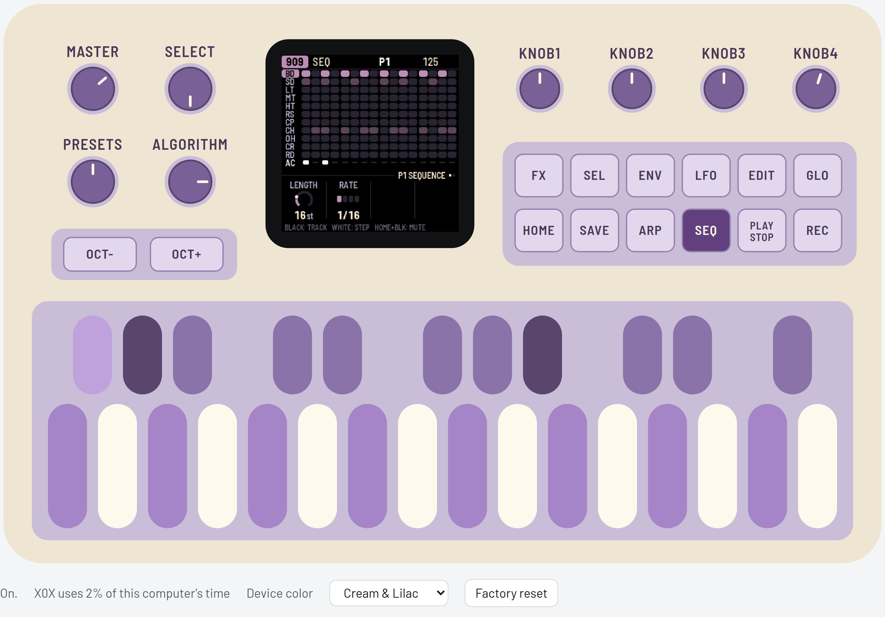
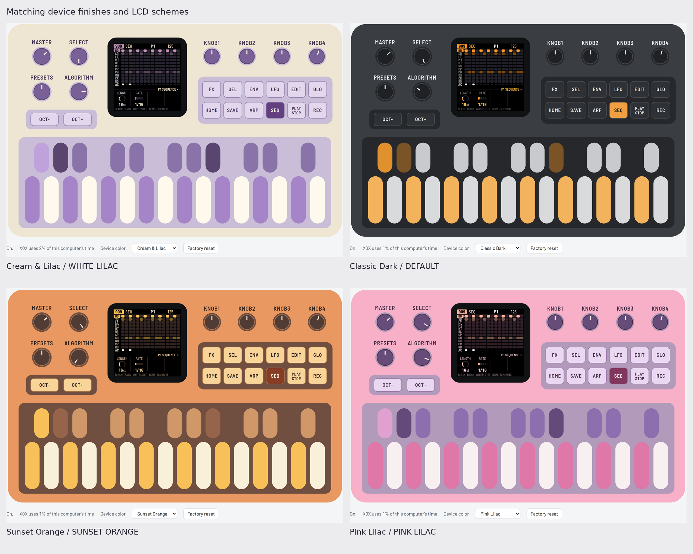

X0X-RMX is an independent fork of [Charles Vestal's X0X](https://github.com/charlesvestal/fm1-x0x),
a stereo groovebox with a **909**, an **808**, two **303s**, a **breakbeat player**, song mode,
knob motion, reverb, tape delay and master compression.



*The default Cream & Lilac exterior, shown with the WHITE LILAC LCD scheme.*

This fork adds:

- **Orb-inspired Remix:** independent Bank A–P / Pattern 1–16 selections for 909, 808,
  303A and 303B; A1 is sequential and BREAK is unaffected.
- **Grids MAP/EUCLID drum generation:** write or mutate kick, snare and closed-hat rhythms
  for 909/808, with FILL, OFFSET, CHAOS and Undo.
- **Extended TB-3PO:** 22 scales and additional phrasing and mutation controls.
- **303 Morph waveform:** Sharkfin through Trapezoid to Notch-Trapezoid, with independent
  Morph values; only one 303 can use Morph at a time. Both voices have **TONE, VOICE and
  EXTRA** EDIT pages for their sound controls.
- **Six LCD color schemes**, plus **Cream & Lilac**, **Classic Dark**, **Sunset Orange** and **Pink Lilac** device finishes
  in the browser emulator.

**Physical FM-1 validation is pending.** Development builds are not advertised as tested
hardware releases. No X0X-RMX public installer or firmware download is enabled in this phase.
Charles' hosted emulator, installer and releases belong to upstream and do not contain this fork.

- **Project website:** [X0X-RMX](https://mr-roboto.github.io/fm1-x0x-rmx/)
- **Play in your browser:** [X0X-RMX emulator](https://mr-roboto.github.io/fm1-x0x-rmx/emu/), with sound, Remix, Grids and both 303 EXTRA pages.
- **Read online:** [manual](https://mr-roboto.github.io/fm1-x0x-rmx/manual/) and [version history](https://mr-roboto.github.io/fm1-x0x-rmx/new/).

The public site is browser-only: firmware installation remains reserved until real-device
validation and release approval. You can also [build and preview the website locally](docs/PAGES.md).

- [Source on orb-remix](https://github.com/Mr-Roboto/fm1-x0x-rmx/tree/orb-remix)
- [User manual](docs/MANUAL.md) and [version history](docs/NEW.md)
- [Remix specification](docs/REMIX_DESIGN.md)
- [Drum generator documentation](docs/DRUM_GENERATOR_CORE.md)
- [TB-3PO scale reference (German)](docs/TB3PO_SCALES.md)
- [TB-303 waveform specification (English summary; German technical record, experimental)](docs/TB303_WAVEFORMS_DESIGN.md)

## A closer look

| Remix | Grids |
|---|---|
|  |  |
| Reorder playback while keeping the stored steps. | Generate kick, snare and closed-hat rhythms. |
| **TB-3PO** | **303 Morph** |
|  |  |
| Generate and mutate bass lines. | Shape the experimental waveform on the EXTRA page. |

### Four emulator device colors

Choose **Cream & Lilac** (default), **Classic Dark**, **Sunset Orange** or **Pink Lilac**
with the emulator's Device color selector. It changes the exterior immediately and remembers
that browser preference separately from your project. The firmware's **GLO → SCHEME** setting
controls LCD colors independently.



*Four browser device finishes with coordinated LCD schemes, selected separately in GLO → SCHEME. These are visual interpretations, not color-matched hardware photographs.*

## What's inside

| Part | What it is | Based on |
|---|---|---|
| 909 | 11 voices: modelled kick, snare, toms, rim and clap, with sampled hats and cymbals | [9W9](https://github.com/athousanddetails/schwung-9W9) (samples from ER-99) |
| 808 | 11 tracks, including the 808's tom/conga, rim/claves and clap/maracas switches | [8W8](https://github.com/athousanddetails/schwung-8W8) |
| 303A | Open303-derived bass synth with Devilfish-style ranges and a TB-3PO line generator | [schwung-303](https://github.com/charlesvestal/schwung-303), [schwung-tb3po](https://github.com/charlesvestal/schwung-tb3po) |
| 303B | A second independent 303 sound and line, with the same controls | Same 303 and TB-3PO sources |
| BREAK | A loop cut into eight slices and rearranged as it plays | [BB Gen](https://github.com/mestela/schwung-breakbeat) |

909, 808, 303A and 303B each have their own length (1–64 steps) and rate, so parts
can drift against each other. BREAK uses a fixed 16-step sequence at 1/16 rate. Pattern changes wait for the end of the bar, and patterns can be chained.

### Experimental Wave 3 in this fork

Each 303's WAVE offers **Saw, Square and Morph**. On EDIT's **EXTRA** page,
**KNOB 1 (MORPH)** blends continuously from **0 = Sharkfin**, through **64 = Trapezoid**, to
**127 = Notch-Trapezoid**. Each voice keeps its own Morph value; new sounds default to 64.

Only **303A or 303B** may use Morph at a time. A conflicting selection is rejected and keeps
the previous accepted Wave; it does not change the other voice or wait to acquire Morph later.
Select Saw or Square on the current Morph voice before transferring Morph to the other voice.

Morph remains experimental: **FM-1 timing and listening validation are pending**.
See the [manual](docs/MANUAL.md#6-303a-and-303b) for the three EDIT pages, parameter behavior
and ownership rules; the [waveform specification](docs/TB303_WAVEFORMS_DESIGN.md) retains
the DSP mathematics and known quality limits.

Original X0X is a fork of [Felucca](https://github.com/hugelton/Felucca) by Leo Kuroshita (Hügelton
Instruments). It keeps Felucca's foundations (the hardware layer, USB, the update loader, the web
installer and the storage) and replaces the instrument on top.

## Your own breaks

X0X-RMX ships with no recorded breaks, only two loops played by its own 909. In the
browser, load your files in **Your breaks** below the device; they stay in that browser.
The retained hardware tooling can load your loops into the FM-1's three sample slots, which hold about nine one-bar loops in total.
The [break loops page](https://mr-roboto.github.io/fm1-x0x-rmx/breaks/) preserves the Chrome/Edge uploader for a compatible
FM-1. See [website preparation](docs/PAGES.md); hardware validation is still pending.
The command-line tool is also retained for developers:

```
tools/upload_breaks.py --bars amen.wav think.wav ...   # take one bar of each and upload them
tools/upload_breaks.py --dry-run OUTDIR ...            # see what fits, without the FM-1
```

Recorded breaks belong to whoever made them and aren't covered by this project's licence.

## Building and testing

[BUILDING.md](BUILDING.md) explains development builds and test prerequisites.
A locally built package is not a physically validated release:

```
tests/run_tests.sh      # the maths, the sequencer, every engine against its original, the app in a simulator
./build.sh              # build/x0x.fwsc
```

`build/host/x0x_host` runs the whole app on a computer from a script (`tests/scenarios/*.x0x`). Button
presses, keys, knob turns and MIDI go in; audio and screenshots come out. That's how most of
X0X is tested before it reaches the FM-1.

## Original X0X – upstream demonstration

[Charles Vestal’s original X0X video (YouTube)](https://www.youtube.com/watch?v=cZLYrZaLDUk)
shows the upstream project on an FM-1. It is a reference for the inherited foundations;
the X0X-RMX features shown above are demonstrated by our browser emulator.

## Licence and credits

X0X-RMX project code is GPL-3.0-only; component notices retain their own terms. Open303
(by Robin Schmidt) is
MIT. BB Gen is ported from mestela's schwung-breakbeat with the author's permission. The 909's
hi-hat, ride and crash samples come from ER-99 (Matthew Cieplak, GPL-3.0). The firmware fonts are Barlow
Semi Condensed and Terminus (SIL OFL 1.1); web pages also use Barlow. The retained
Fukiai web icon font is MIT-licensed.

Grids MAP data and arithmetic are by Emilie Gillet / Mutable Instruments (GPL-3.0-or-later),
cross-checked against DEADACTIVE's Hortator port. See [LICENSING.md](LICENSING.md) and
[Grids source attribution](assets/grids/README.md) for component provenance, notices and records still to confirm.

Felucca's own assets that aren't under its GPL (the icon set, the panel photo and the Hügelton
drum pack) aren't part of this fork.

M-VAVE and FM-1 are trademarks of their owners. TR-808, TR-909 and TB-303 are Roland trademarks,
used here only to describe what the parts are modelled on. X0X-RMX is an independent fork, without implied endorsement by Charles Vestal. It isn't affiliated with or endorsed
by M-VAVE, Roland or Hügelton Instruments.
