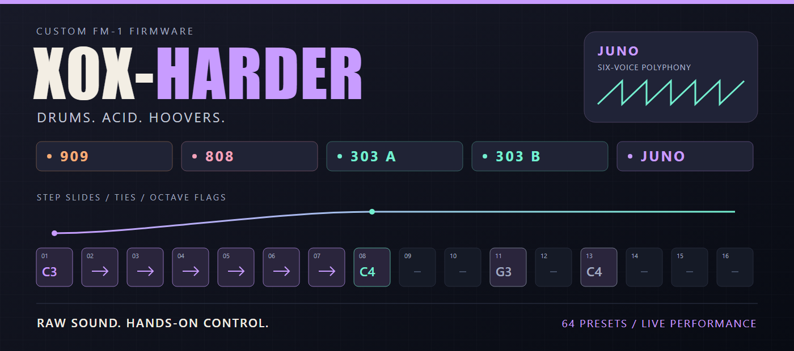

# X0X-HARDER



**909 drums. 808 drums. Two acid engines. A six-voice hoover machine.**

X0X-HARDER is custom groovebox firmware for the **M-VAVE FM-1**, with a matching
browser emulator. It brings together drums, dual 303s and an Alpha Juno-inspired
synth for hands-on sequencing, hard slides and live performance. The current
build has been tested on a real FM-1 with all five engines and six Juno voices.

## Built on these projects

This project builds directly on two FM-1 firmware projects:

- **[Mr-Roboto / X0X-RMX](https://github.com/Mr-Roboto/fm1-x0x-rmx)**: the RMX
  foundation, including Orb-inspired Remix, Grids drum generation, expanded
  TB-3PO scales, Morph waveforms and the existing interface and tools.
- **[Charles Vestal / X0X](https://github.com/charlesvestal/fm1-x0x)**: the original
  X0X groovebox, instrument ports and platform work, plus selected upstream
  performance improvements and bug fixes integrated into this branch.

The Juno engine takes its design and raw waveform reference from
**[mikerodd / June-21](https://github.com/mikerodd/june-21)**, a Csound/Cabbage
Alpha Juno 2 emulator. X0X-HARDER implements the synth in C for the FM-1;
June-21's oscillator gate relationships informed the saw, pulse and sub modes.
It favours a raw, immediate sound over circuit-accurate emulation or oversampling.
See the [waveform notes and reference checks](docs/JUNO_SAW.md).

## New in X0X-HARDER

- **Six-voice JUNO replaces BREAK** in the hardware and browser builds. Saw,
  pulse, sub and noise sources, resonant filter, four-stage envelope, LFO,
  chorus and 44 sound controls spread across EDIT pages.
- **64 playable Juno presets**: original starting recipes for classic synth
  textures, hoovers and rougher sounds. PRESETS selects sounds on JUNO EDIT;
  an asterisk marks edits, and SAVE retains them. These are not imported Roland
  factory patches. [Browse the bank](docs/JUNO_PRESETS.md).
- **Juno voice and performance controls**: POLY, MONO and LEGATO, keyboard glide,
  an editable 16-step trance gate, and an arpeggiator with UP, DOWN, UP/DOWN,
  DOWN/UP, AS PLAYED and RANDOM orders, octave range, rates and latch.
- **A Juno x0x sequencer**: 16 steps, the 303 generator's 22 scales, white-key
  step selection and black-key note entry. ROOT, SCALE, OCTAVE and NOTE LEN
  are on the stopped SEQ page; playback exposes the normal sound pages with
  parameter locks and recorded knob motion.
- **Hoover slides, ties and note octaves**: ENV cycles normal, tie, slide and
  tie + slide. Slides span intervening ties and arrive on the next pitched
  step, following tempo and swing. OCT +/- toggles per-step octave flags;
  arrows and slide marks show them on screen.
- **Juno DJ filter and stronger output**: its MIX page adds a centred LP/OFF/HP
  filter alongside level, reverb and delay sends. Juno has a +15 dB boost before
  the mixer and sends, including the latest additional +12 dB increase.
- **Dual 303 upgrades**: an HPF on each engine, plus a fourth EDIT page for
  HPF, pan, reverb and delay, all parameter-lockable. 303B can mirror 303A's
  pattern with an independent transpose offset.
- **Live mode**: press HOME three times from EDIT for ACID1, ACID2, FEEDBACK and
  a DRUMS DJ filter. White keys transpose both 303s in semitones, with key 8 at
  zero; changes can be immediate or queued to the next bar, with flashing LEDs.
  Black keys provide part mutes and momentary rolls/percussion fills. ENV resets
  FEEDBACK and DRUMS while keeping the acid controls where they are.
- **Better hi-hat control**: 909/808 open- and closed-hat velocity, including
  per-step locks, plus a 0-500 ms hold before the 909 open hat's decay.
- **Timing and compatibility fixes**: continuous Juno pitch/filter update timing
  across sequencer boundaries, fixed hat velocity/default behaviour, and
  migration that reuses existing project storage for the new Juno controls.

The inherited foundations remain: independent drum/303 lengths and rates,
Orb-inspired Remix, Grids MAP/EUCLID, TB-3PO generation and mutation, song mode,
parameter locks and motion, stereo mixing, reverb, tape delay and master compression.

## Juno sequencer: a quick example

On JUNO, press **SEQ**. Select a white step, then use the black keys for its note.
The selection stays on that step after releasing the white key.

| Control | In Juno SEQ |
| --- | --- |
| Knobs while stopped | ROOT / SCALE / OCTAVE / NOTE LEN |
| ENV | NORMAL -> TIE -> SLIDE -> TIE + SLIDE |
| OCT+ / OCT- | Toggle the selected step one octave up/down |
| SELECT or SEQ while playing | Browse the sound pages |
| Hold a white step + turn a knob while playing | Set that step's parameter lock |

**C3 + SLIDE -> TIE -> TIE -> C4** sweeps an octave over three sixteenth-note
intervals, reaching C4 at step 4 without restarting the envelope. A rest breaks
the connection. Keyboard GLIDE in SEL -> EXTRA remains independent of sequencer
slide timing. See the [full Juno controls](docs/JUNO_PERFORMANCE.md).

## Build, play and install

This is a development firmware branch. The upstream projects' hosted emulators,
installers and release downloads contain their own firmware, not X0X-HARDER.

- [Build instructions and prerequisites](BUILDING.md)
- [Juno performance and sequencer guide](docs/JUNO_PERFORMANCE.md)
- [64 Juno presets](docs/JUNO_PRESETS.md)
- [Inherited manual](docs/MANUAL.md) - use the Juno guide for the replaced BREAK part
- [Upstream integration notes](docs/UPSTREAM_FIXES_INTEGRATION.md)

Build the FM-1 firmware from the repository root:

```sh
./build.sh
# Output: build/x0x.fwsc
```

Save and back up your project before flashing. With the build prerequisites and
Python MIDI dependencies installed, the updater can install the local package:

```sh
python tools/fm1_install.py build/x0x.fwsc --port FM-1
```

For the browser emulator, install Emscripten, then run:

```sh
sh web/emu/build.sh
python -m http.server 8765 --directory build/emu
```

Open http://localhost:8765 and start the audio. The emulator uses the same Juno
engine and sequencing code as the hardware. The standard native host retains
BREAK for historical reference tests; the Juno-specific tests select the current
hardware profile explicitly.

## Validation

The current hardware build retains **six Juno voices** alongside the other four
engines. Image: **391,484 B**; static RAM: **96,928 / 98,304 B**; pool:
**333,768 / 344,064 B**. The latest gain build was flashed and its saved project
read back unchanged.

Focused native and WebAssembly checks cover presets, voice modes, arp, gate,
step entry, locks, ties/slides, internal/external clock, swing and save/reload.
A BRIGHT HOOVER regression compares plain ties with a held note through the full
mixer/effects/master path, sample for sample.

```sh
sh tests/host/run_juno_performance.sh
sh tests/host/run_juno_hardware.sh
# After building the emulator:
node tests/host/juno_slides_emu_test.mjs build/emu/x0x.wasm
```

See [tests/run_tests.sh](tests/run_tests.sh) for the wider suite and optional
external-reference checks.

## Credits and licence

X0X-HARDER retains the upstream **GPL-3.0-only** project licence and component
notices. Full terms and credits are in [LICENSE](LICENSE) and
[LICENSING.md](LICENSING.md).

Alongside **Mr-Roboto**, **Charles Vestal** and **mikerodd / June-21**, credit goes
to [Felucca](https://github.com/hugelton/Felucca) for the platform foundations;
9W9 / ER-99 and 8W8 for the drum sources; Open303, schwung-303 and schwung-tb3po
for the acid engines and generator; Mutable Instruments Grids for the drum map;
and the other contributors named in the component credits. Historical BREAK
sources and their attribution remain in the tree.

M-VAVE, FM-1, Roland, TR-808, TR-909, TB-303 and Alpha Juno are names/trademarks
of their respective owners. This is an independent project without implied
endorsement by the hardware manufacturers or upstream authors.
