# X0X-RMX

X0X turns the M-VAVE FM-1 into a groovebox: a 909, an 808, two 303s and a breakbeat player,
all playing at once, in stereo. Each part can play its own pattern, you can arrange patterns
into a song, record knob moves, and give single steps a sound and a chance of their own.

This manual covers **X0X-RMX v1.0.1 Stable**, approved for public release after
successful installation and hardware checklist items 1–8 on a real M-VAVE FM-1.
MREV, Remix restoration, both MORPH warning paths, save/restart and existing
project/user-sample data passed. The device ran stably without audible dropouts
or unexpected interruptions. External MIDI clock, a dedicated extended
performance test and physical interrupted-update recovery were not tested.
See [v1.0.1 release notes](RELEASE_1.0.1.md), including the saved-direction compatibility change.

X0X-RMX is a fork of Charles Vestal's X0X. **v1.0.0 Stable** was successfully tested on a real M-VAVE FM-1. Hardware testing
confirmed the regular update, retained patterns/user breaks, restored manual startup patterns,
pattern chains and a twelve-minute musical run without reported problems. USB audio with
iPad/AudioShare was confirmed successful, as was real-device operation of the sequencer,
drums, bass synths, effects and breakbeat engine. The
[public browser emulator](https://mr-roboto.github.io/fm1-x0x-rmx/emu/) and documentation
are available. See [website details](PAGES.md).
See [What's new](NEW.md).


Screenshots captioned **X0X-RMX** are real browser-emulator captures (the three Remix
images were refreshed for P9; other captures predate 1.0.0),
with the Cream & Lilac exterior and WHITE LILAC LCD scheme selected independently.
The retained hardware drawings and screenshots captioned **Original X0X** describe the
inherited controls and workflows; their layout and colors may differ from the fork.

---

## Contents

1. Browser emulator and installation status
2. Getting started
3. Controls
4. The screen
5. 909 and 808
6. 303A and 303B
7. TB-3PO
8. Break
9. Patterns
10. Recording
11. Knob motion, p-locks and probability
12. Song
13. Effects
14. Mix and master
15. Settings and saving
16. MIDI and USB audio
17. Troubleshooting
18. Parameters
19. Credits

---

## 1. Browser emulator and installation status

**Try it first:** open the [public X0X-RMX emulator](https://mr-roboto.github.io/fm1-x0x-rmx/emu/)
and click **Switch on**. It runs the fork's instruments and sequencer with sound; you do not
need an FM-1 or a local build. For developers, [local preview instructions](PAGES.md) are also available.

### Browser controls and storage

Drag knobs up/down or scroll over them. Click or touch buttons and keys. With a mouse,
Shift-click or right-click a button to latch it down for a combination; click it again to
release it. For example, latch HOME, click REC for Undo, then release HOME. Touch screens
can hold several controls at once.

| Computer key | Device control |
|---|---|
| Q W E R T Y U I | White keys 1–8 |
| A S D F G H J K | White keys 9–16 |
| 1 2 3 4 5 6 7 8 9 0 - | Black keys 1–11 |
| Space / Enter | PLAY / REC |
| Shift / Esc | SEL (held) / HOME |
| Z / X | OCT- / OCT+ |
| Up / Down arrow | Turn SELECT |

Use **SAVE** on the illustrated device to keep project data in this browser. Loaded breaks
are kept separately in browser storage. Storage is local to the site and browser profile;
it is not an account backup, a hardware transfer or an export file. If storage is unavailable,
changes last only for the session. Clearing site data can erase saved projects and breaks.

The **Factory reset** button below the device requires a second click, then deletes the saved
browser project and reloads. This clears Undo history; it does not remove loaded break slots
or the device color choice. This differs from GLO > FACTORY RESET inside the device, which
is an undoable project edit until you close or reload the emulator.

**Device color** offers Cream & Lilac (default), Classic Dark, Sunset Orange and Pink Lilac.
It switches the exterior illustration without restarting
or stopping playback. It is saved separately from patterns and sound. It colors the device
illustration; **GLO > SCHEME** colors the LCD. Cream & Lilac is an interpretation of a hardware
finish, not a color-matched product photograph.

New projects and factory resets start with the **WHITE LILAC** LCD scheme. Saved projects
keep their selected scheme; older projects without a valid scheme tag retain the
original **DEFAULT** colors.

The emulator uses browser audio rather than the FM-1's physical audio, USB, MIDI jacks,
battery and processor cores. It does not expose the hardware MIDI/USB-audio interfaces.
Successful browser playback does not validate physical FM-1 performance or installation.

**Install/update:** [Install X0X-RMX v1.0.1](https://mr-roboto.github.io/fm1-x0x-rmx/install/)
with Chrome or Edge, or [download x0x-1.0.1.fwsc](https://mr-roboto.github.io/fm1-x0x-rmx/firmware/x0x-1.0.1.fwsc).
The [GitHub release](https://github.com/Mr-Roboto/fm1-x0x-rmx/releases/tag/v1.0.1) includes
release notes and a SHA-256 checksum. The tested product identity is FM-1_987010001.
Upstream X0X and Felucca installers install their respective firmware, not X0X-RMX.

The existing command-line installer, update loader and recovery tools are retained.
A regular X0X-RMX update keeps the project and the three user sample slots, confirmed in
the release hardware test. Installing another firmware can replace its storage. See
[BUILDING.md](../BUILDING.md) and
[Recovering an FM-1 that will not start](#recovering-an-fm-1-that-will-not-start) for recovery.

---

## 2. Getting started

A five-minute tour, from switching on to saving your first beat. A new project starts on the
909 with every part empty; a saved project restores its previous contents. In the browser,
click Switch on first.

1. **Add a kick.** Press black key 1 to pick the bass drum (you'll hear it), then press white
   keys 1, 5, 9 and 13.
2. **Press PLAY.** The kick plays on every beat.
3. **Add a clap.** Press black key 7, then white keys 5 and 13. While the pattern plays, picking
   a drum is silent, so you don't add a stray hit.
4. **Add open hats.** Press black key 9, then white keys 3, 7, 11 and 15.
5. **Write a 303 line.** Turn ALGORITHM two clicks clockwise to 303A and press ARP. Press OCT+:
   each press writes a new line. Keep going until you like one.
6. **Shape the 303.** Press EDIT and turn SELECT fully left to TONE. The knobs are the 303's filter: KNOB 1 opens and closes it,
   KNOB 2 sets the resonance.
7. **Add the break.** Turn ALGORITHM two more clicks to BREAK and press all 16 white keys, so the
   break plays the whole bar.
8. **Mute a part.** Press HOME, then black key 5 to mute the break. Press it again to bring it
   back.
9. **Record a filter sweep.** Turn ALGORITHM back to 303A, press EDIT and select TONE. Press REC, slowly turn
   KNOB 1 for a bar or two, then press REC again. The sweep now plays every time the pattern
   comes round.
10. **Save.** Press PLAY to stop, then SAVE. Everything is kept when you switch off. (X0X also
    saves by itself a few seconds after you stop; see section 15.)

Next: section 9 shows how to make more patterns and switch between them, and section 12 how to
arrange them into a song.

---

## 3. Controls

The drawing at the top of the manual names every control. In more detail:

A button that opens a screen always opens the same one; press it again for that screen's next
page. SEQ, EDIT and ARP show the part you choose with ALGORITHM.

| Control | What it does |
|---|---|
| MASTER | Volume. |
| SELECT | The previous or next page. In a list, up and down. Hold a step and turn it for the step's chance (section 11). |
| PRESETS | The next pattern: on a part's screen for that part only, on HOME for all five. |
| ALGORITHM | The part: 909, 808, 303A, 303B or BREAK. In a list, it changes the value. |
| OCT-, OCT+ | The steps, 16 at a time (1–16 … 49–64). On HOME and SONG, patterns 1–16 or 17–32. On the 303 keyboard, the octave. In a generator, mutate or write a new pattern. |
| KNOB 1–4 | The four values at the bottom of the screen. Each click is one step, however quickly you turn a few; spin and they speed up. Hold ENV and turn one to reset it to its defined parameter default (v1.1.0 development). |
| FX | The reverb and the delay. |
| SEL | Everything on this screen as a list, including the settings on no page (see Lists). In a question, yes. |
| ENV | Hold while pressing keys: an accent. Hold and turn KNOB 1–4 to reset that parameter to its default (v1.1.0 development). |
| LFO | The mixer and the master. Hold while pressing keys: a slide. |
| EDIT | The selected part's sound. The keys still write its steps. |
| GLO | The settings. Press again to close. |
| HOME | The pattern: all five parts, which pattern they play, mutes. Again: the song, and again back. In a list, back; in a question, no. |
| SAVE | Save everything (while playing: when you stop). Hold it to copy the pattern; then a white key pastes it. |
| ARP | GRIDS on 909/808; TB-3PO on 303A/303B. Again: the next generator page. |
| SEQ | The selected part's steps, with its LENGTH and RATE (on a 303 also DIRECTION and TRANSPOSE). |
| PLAY | Start and stop. |
| REC | Record on and off: drum hits, 303 notes, knob moves, and on the SONG screen the song. On a 303 the keys become a keyboard while it's on. |
| White keys | Steps. On HOME, patterns. On MASTER and FX they do nothing. |
| Black keys | Drum tracks, or the break's slices. On HOME they mute parts; on the mixer they pick a channel. |

**Hold HOME** for these: + REC undoes, + PLAY redoes, + SELECT sets the tempo, + a white key picks
a pattern from any screen, and + a black key mutes a drum track (on the 909 or 808 screen) or a
channel (on the mixer).


(The SEL button is labelled SCL in Felucca.)

### Lists

SEL turns the screen you're on into a list of everything on it: every knob from its pages,
grouped (on the 909, for example, BD: THIS TRACK and 909: ALL TRACKS), and then **MORE**, the
settings that are on no page. MORE is where the less used settings live, such as a drum
track's DRIVE and DIST or the compressor's details.

In a list, SELECT moves, ALGORITHM changes the highlighted value, and SEL runs a row with a
return arrow (an action). HOME goes back. Menu actions such as CLEAR PATTERN, FACTORY RESET and pasting over an occupied pattern
ask for confirmation: SEL for yes, HOME for no. Generator NEW/MUTATE commands act immediately;
use Undo to take them back.


> **Not sure what a button does?** Hold it for a second on its own: a card says what it does on
> the screen you're on, with its combinations. Let go and nothing happens.

### Undo

Hold HOME and press REC to take back your last change; the screen says what it undid, for
example UNDO 909 P1. HOME + PLAY redoes it. You can go back up to 32 edits (fewer after very big
changes). An edit is whatever you did before pausing for a moment: a few steps tapped in a row,
one turn of a knob, or a whole recording pass. Undo covers the sounds, patterns, song and knob
motion, even CLEAR PATTERN and the sound/pattern/song changes from FACTORY RESET, but not the
tempo or GLOBAL settings. Undoing FACTORY RESET does not restore those settings. The history is
cleared when you switch off or reload the browser emulator.

<details><summary>What the key lights show</summary>

The key lights have two levels: bright for what is on or chosen, dim for what is there to
choose.

| Screen | Bright | Dim |
|---|---|---|
| HOME | the pattern playing (a cued one blinks); the parts playing | patterns with notes; muted parts |
| SONG | the bar's pattern; the bar's parts | patterns with notes; the bar's muted parts |
| 909 / 808 | the track's hits; the track | the other tracks with hits |
| 303 | notes | ties |
| 303 with REC on | the keys you hold | the Cs, to find your place |
| BREAK | the steps it plays | the slice pads 1–8 |
| Mixer (PARTS, 909 MIX, 808 MIX) | the channel the knobs set (blinking while muted) | the other channels |

</details>

---

## 4. The screen


The **top line** shows, from left to right:

- the part, in its color (with DEFAULT: 909 orange, 808 red, 303A green, 303B blue, BREAK violet), and the
  screen if it isn't the sound: SEQ, TB-3PO, or KEYS while the 303 keyboard is on;
- the pattern playing, such as P3. P3 >5 means pattern 5 is coming up next. On a part longer
  than 16 steps, the steps the white keys show follow (33-48);
- the tempo, amber when X0X follows an external MIDI clock;
- a play symbol while playing and a red dot while recording. A small grey dot means there are
  unsaved changes.

When a button does something, the top line says what for a second, for example SAVED or P1
PASTED TO P5.

The **knobs** sit under a tag that says whose they are: the selected track (BD), the whole
machine (909 KIT), a 303's sound (303A TONE), the pattern (P3 SEQUENCE), the mixer (PARTS: 303A,
909 MIX: CP), a held 303 step on SEQ (303A STEP 5), or a p-lock (BD P-LOCK STEP 5). When a
section has more than one page the tag counts them (BD (1/2)), and the dots at the end of the
line are all the screen's pages, the current one lit. Settings with only a few choices show a
row of small squares instead of a ring.

When you turn a knob, its value shows in large type for a second, with whose it is: a track's
(BD TUNE) or a pattern's (P3 LENGTH). Settings that belong to the pattern change when the
pattern does, and are copied with it; the sound stays the same whatever pattern plays.

The **footer** at the very bottom says what the keys do on this screen (BLACK: TRACK, WHITE:
STEP). Until you first press a button it says HOLD ANY BUTTON: WHAT IT DOES.


---

## 5. 909 and 808

Each drum machine has eleven tracks, one on each black key:

| Key | 909 | 808 |
|---|---|---|
| 1 | Bass drum (BD) | Bass drum (BD) |
| 2 | Snare (SD) | Snare (SD) |
| 3–5 | Low, mid and high tom | Low, mid and high tom, or congas |
| 6 | Rim shot (RS) | Rim shot, or claves |
| 7 | Clap (CP) | Clap, or maracas |
| 8 | Closed hat (CH) | Cowbell (CB) |
| 9 | Open hat (OH) | Cymbal (CY) |
| 10 | Crash (CR) | Open hat (OH) |
| 11 | Ride (RD) | Closed hat (CH) |

The 909's hats and cymbals are samples, as on the original machine; every other sound on both
machines is synthesized. On the 808, a track's SOUND setting switches it between tom and conga,
rim and claves, or clap and maracas. On both, the closed hat cuts off the open hat.

**Writing a beat.** Press a black key to pick a track; while the pattern is stopped you hear it
too. (While it plays, picking is silent so you don't add a stray hit; GLO > KEY SOUND = ALWAYS
changes that.) Then press white keys: an empty step turns on, and a tap on a step that's on
turns it off. Hold ENV while pressing white keys to place accents instead; an accent makes every
drum on that step louder.

A pattern can be up to 64 steps long. The white keys show 16 at a time: OCT+ moves to the next
16 and OCT- back, and the top line shows which 16 you're on.

**Muting a track:** hold HOME and press its black key; again to bring it back. A muted track's
row turns grey. Track mutes aren't saved, and muting the whole part on HOME leaves them as they
are.

**Step numbering.** White key 1 is the first step on the visible page: step 1, 17, 33 or 49.
Key 16 is the last step on that page: step 16, 32, 48 or 64. LENGTH determines how many
chronological steps play; the keys still address stored steps on the selected page.

**The pages.** EDIT shows the selected track's sound (one page, two for the 909's kick), then KIT
with ACCENT, how much louder accented steps are. A track's DRIVE and DIST are in SEL's list,
under MORE. SEQ has the machine's LENGTH and RATE. SWING is on HOME, because it swings every part.

Each track's level, pan and reverb and delay sends are on the mixer: press LFO and go to 909 MIX
or 808 MIX, which shows all eleven levels at once. The black keys pick a track and the knobs are
its LEVEL, PAN, REV and DLY. On the 808 the alternate sounds share their track's pan, so the
conga sits where the tom does.

### Grids drum generator

Pick 909 or 808 and press **ARP**. **OCT+** writes a new Kick, Snare and Closed
Hi-Hat rhythm into the current pattern; **OCT-** mutates it. The other eight
instrument rows, length, rate, Remix selection and hidden steps are retained.

ARP again, or SELECT, moves through **three pages: MAP or EUCLID, then FILL, then OFFSET**.
MAP and EUCLID are alternative first pages, selected by MODE; they are not a fourth page:

| Page | Knob 1 | Knob 2 | Knob 3 | Knob 4 |
| --- | --- | --- | --- | --- |
| MAP | X | Y | CHAOS | MODE |
| EUCLID | LEN K | LEN S | LEN H | MODE |
| FILL | FILL K | FILL S | FILL H | Unused |
| OFFSET | OFF K | OFF S | OFF H | Unused |

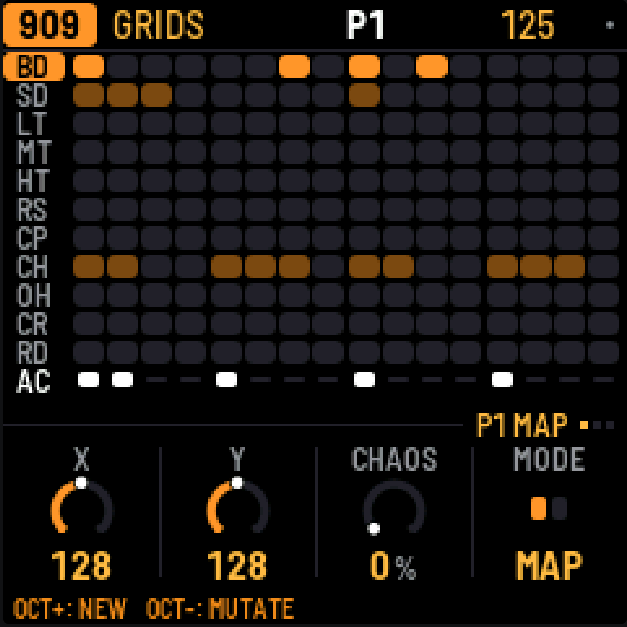
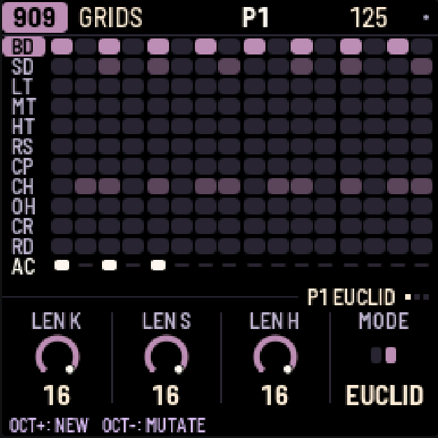

MODE chooses MAP or EUCLID as the first page. MAP blends original Mutable
Instruments Grids rhythms using X/Y; FILL controls density and CHAOS varies
successive 16-step bars. CHAOS 0 gives identical full MAP bars and makes MAP MUTATE a no-op. CHAOS does not
control EUCLID mutation.
EUCLID repeats three independently sized, evenly spaced cycles with an exact
rounded hit count from FILL. LEN is bounded by 32 and the current pattern length.
Positive OFFSET rotates later, wrapping within 16 steps for MAP or LEN for EUCLID.

EUCLID MUTATE shifts only Snare or Hi-Hat by +2 or −2, selecting an effective
rotation and updating OFFSET. **NO CHANGE** means there was no effective edit.
**NEW FIRST** means stored Snare/Hi-Hat steps no longer match the current knobs;
press **OCT+ (NEW)** explicitly to regenerate them before mutating. MAP MUTATE attempts
a few changes near the chosen density, preserving strong hits; it can also leave the beat unchanged.

909 and 808 keep separate generator settings for the session. Pattern changes
retain them, shorter patterns clamp LEN/OFFSET, and restart restores defaults.
To try a rhythm: choose MODE with KNOB 4 on the first page, set X/Y/CHAOS or LEN K/S/H,
then use FILL and OFFSET to set density and rotation. Press OCT+ to hear the result, OCT-
for a variation, or HOME + REC to undo it. FILL K/S/H addresses Kick/Snare/Closed Hi-Hat.
FILL and CHAOS range from 0 to 100%; MAP X/Y from 0 to 255. MAP OFFSET is 0–15; EUCLID
OFFSET is 0–LEN−1. NEW writes stored steps, so an enabled Remix can reorder what you hear.

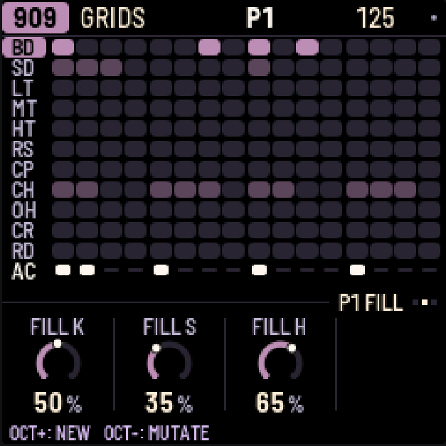
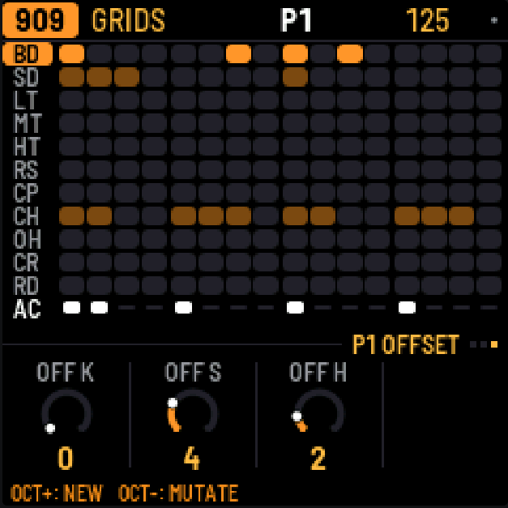

Turning generator knobs changes the next operation, leaves current steps alone,
and is not saved or recorded as motion.

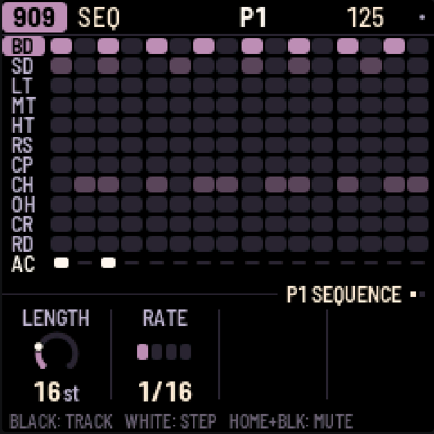

Generated accents use the shared accent row, so other drums on the same column
sound accented too. Existing accents coincident with unrelated instrument hits
are protected. Accent provenance is unavailable: manual target-only accents may
be cleared, while protected or orphaned old accents may remain.

Each effective command is a separate Undo edit: **HOME+REC** undoes and
**HOME+PLAY** redoes pattern data. Knobs and seeds stay current; Undo can therefore
make EUCLID MUTATE show NEW FIRST. A no-change command adds no Undo entry.

---

## 6. 303A and 303B

There are two identical 303s. Each has its own sound and its own line.


**Steps.** Press a white key to turn that step on; tap it again to turn it off. To edit a step,
press SEQ, hold the step's key and turn the knobs: KNOB 1 sets the note, KNOB 2 the gate (REST,
NOTE or TIE), KNOB 3 the accent and KNOB 4 the slide. OCT- and OCT+ move the held note an octave.
An empty step turns on as soon as you press it, so you can press, hold and set its note in one
go. A slide glides from this step's note into the next one. (Holding a step on EDIT gives it a
sound of its own instead: see P-locks in section 11.)

A **tie** holds the note before it through the step, so it doesn't play again. On the screen a
tied note joins the note it holds in one long bar. Turning KNOB 1 on a tie makes it a note of
its own.

**Keyboard.** Press REC and all 27 keys become a keyboard (KEYS shows on the top line). The
notes you play are written: step by step while the pattern is stopped, live while it plays.
OCT- and OCT+ change the octave. Play a key while still holding another and the 303 slides
between them. Press REC again to go back to steps.

**Free play.** To play the 303 without writing anything, press SEQ, turn SELECT to the third page, KEYS
and set FREE PLAY to ON. The keys then play the 303 on every 303 screen, stopped or playing, so
you can try lines and turn EDIT's knobs as you go; the top line says FREE PLAY. Nothing is
written until you press REC, which records as above. Set FREE PLAY back to OFF for the steps.
Each 303 has its own, and both are off at power-on.

**The pages.** Both 303A and 303B have three EDIT pages. Press EDIT repeatedly to cycle
**TONE → VOICE → EXTRA → TONE**, or turn SELECT to move between pages (SELECT stops at
TONE and EXTRA). Each voice remembers its own page.

| EDIT page | KNOB 1 | KNOB 2 | KNOB 3 | KNOB 4 |
|---|---|---|---|---|
| TONE | CUTOFF | RESO | ENVMOD | DECAY |
| VOICE | ACCENT | WAVE | DRIVE | SLIDE |
| EXTRA | MORPH | ACCDEC | DRVTYPE | TUNE |

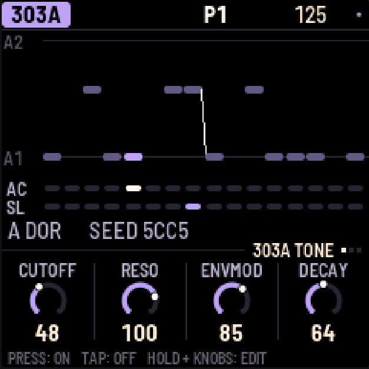
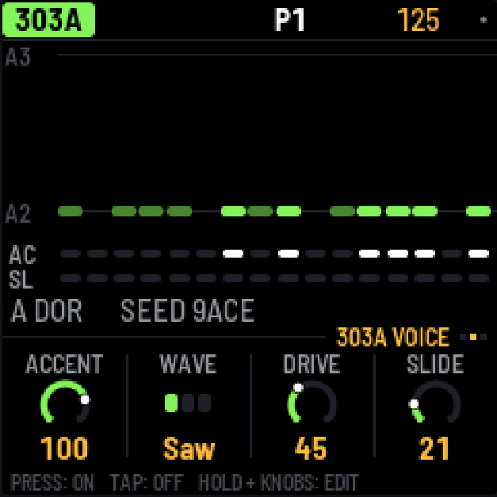
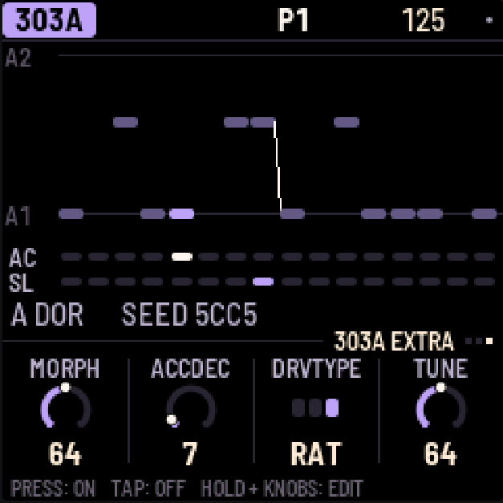

WAVE offers **Saw, Square and Morph**. EXTRA uses the existing Morph, accent decay,
drive type (off, soft or RAT) and tuning controls, with unchanged ranges and defaults.
ACCDEC sets accented-note decay (30–3000 ms). DRVTYPE chooses Off, Soft or RAT;
DRIVE on VOICE sets the amount (0–127), with 0 bypassing drive. TUNE sets the reference pitch,
not the pattern transpose. SEL lists these with the page parameters in the same order; only VOLUME remains under
**MORE**. SEQ has the line's LENGTH (1–64 steps), RATE, DIRECTION and TRANSPOSE.
Direction choices are **FWD → REV → MREV → PING → RND**. FWD plays forwards; REV starts
at the last step and plays backwards. **MREV (Musical Reverse)** starts at step 1, then
plays the remaining steps backwards: `1 → 16 → 15 → … → 2 → 1` for length 16.
It follows the configured length, including 1–64 steps: length 8 plays
`1 → 8 → 7 → … → 2 → 1`; length 1 repeats step 1. PING and RND retain their
ping-pong and random traversal. Each 303's level, pan and sends are on the mixer (LFO).

**Saved direction compatibility in v1.0.1:** the stored values are now
0 FWD, 1 REV, 2 MREV, 3 PING, 4 RND. There is no migration: v1.0.0 patterns saved
as PING (2) play MREV, and those saved as RND (3) play PING. Select the desired
direction again and save. FWD and REV retain their values. The pattern layout is unchanged.

**Morph (experimental Wave 3).** Pick 303A or 303B with ALGORITHM, press EDIT and turn SELECT
to VOICE. Set WAVE to Morph with KNOB 2, then move to EXTRA and use KNOB 1 to change MORPH.
MORPH also remains available in SEL's normal sound parameter list.

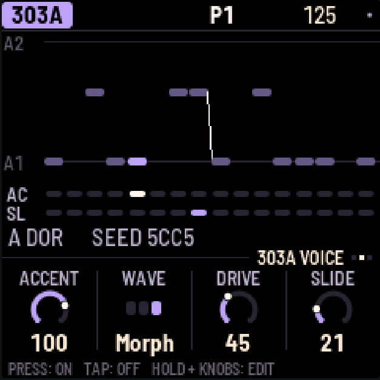

| Morph | Shape |
|---|---|
| 0 | Sharkfin: a curved falling ramp with an upward reset |
| 64 | Trapezoid: two plateaus joined by sloping edges |
| 127 | Notch-Trapezoid: a trapezoid with a triangular notch in the upper plateau |

Intermediate values blend continuously. New sounds default to 64. Older saved sounds with a zero in the previously unused Morph
byte load as 0; they are not automatically reset to 64. Each 303 stores its own Morph
value, including while Saw or Square is selected; Morph only affects the Morph waveform.
While Morph is sounding, changes slew over at most about 5 ms. Setting it while the voice is
idle settles immediately.

**One Morph voice at a time.** If 303A uses Morph, a Morph selection on 303B is rejected and B
keeps its prior accepted Wave. A rejected user selection through the WAVE knob or
SEL parameter list briefly shows exactly **MORPH IN USE** in the header, above the
normal value readout. Playback, motion and project loading do not show this warning.
The same applies with A and B reversed. The other voice is not
forced to change. Set the current owner to Saw or Square before selecting Morph on the other
voice. A rejected choice does not become active later when the owner releases it; make a new
selection. Direct parameter changes and Wave motion obey the same rule.

SAVE stores accepted Wave settings and both Morph values. A rejected Morph choice is not
saved as successful. If a loaded project contains Morph on both voices, A keeps Morph and B
loads Saw; their Morph values remain independent.

Wave 3 uses cubic four-box BLEP/BLAMP correction. The existing Saw/Square DSP, 2× default
oversampling, overload guard, filters and drive remain unchanged. **Dedicated Morph worst-case timing and
listening tests were not separately reported.** The successful release hardware run and host
tests do not establish universal realtime performance or audio quality. The
[waveform specification](TB303_WAVEFORMS_DESIGN.md) describes the implementation and remaining limits.

---

## 7. TB-3PO

TB-3PO writes 303 lines for you. Pick a 303 with ALGORITHM and press ARP.

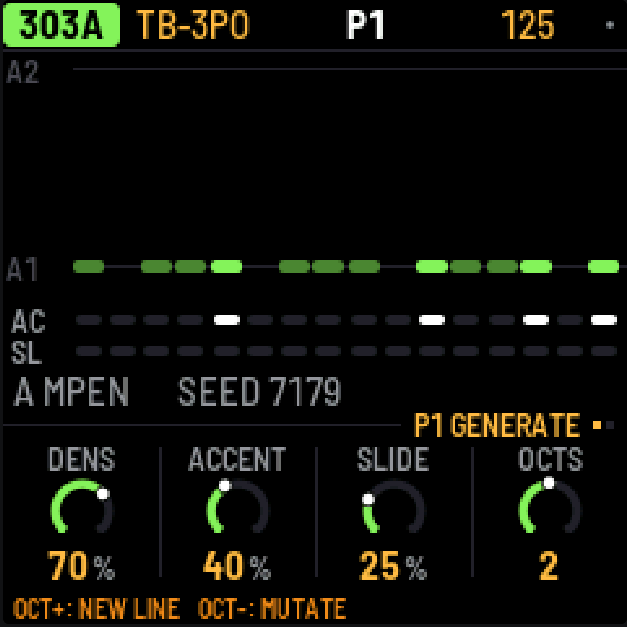

Press **OCT+** to write a completely new line, or **OCT-** to mutate the current one
(a few small edits that retain the melodic anchors).

TB-3PO has two pages (press ARP again, or turn SELECT):

- GENERATE: DENS, ACCENT and SLIDE set how many steps play, are accented and slide. OCTS sets
  the range, from 1 to 3 octaves.
- SCALE: ROOT, SCALE (22 scales; new generator configurations default to Minor Pentatonic / MPEN),
  OCTAVE, and MUTATE, which mutates the line by itself every 1–16 bars (or never).

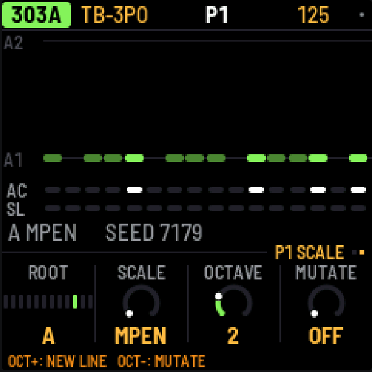

DENS, ACCENT, SLIDE, OCTS, ROOT, SCALE and OCTAVE do not immediately rewrite the line.
They set up the next OCT+ or OCT-; the written line, including hand edits, stays unchanged
until a generation/mutation command or an enabled automatic mutation runs. MUTATE schedules
that automatic mutation independently. When the knobs no longer
match the line, the screen shows NEW LINE with a star. The same settings and seed always give
the same line. Historical Schwung generator output is no longer identical.

The line uses short four- or eight-step motifs with recognizable root anchors. A 16-step
line pairs a question with a small rhythmic and melodic answer. Longer lines combine two
related motifs and develop their answers, rather than stretching one phrase across the
whole pattern. All lengths from 1 to 64 steps work, including 18 or 24: partial final phrases
end at the selected length and connect back to the start. Beats stay on the four-step grid;
offbeats and anticipations retain their syncopation.

Root and fifth are preferred; a fifth is used only when it belongs to the chosen scale.
Other scale tones add colour. Register choices stay close, with generated melodic moves no
larger than seven semitones, including the loop boundary. OCTS makes higher registers
available, while favoring the lower octave.

DENS sets the approximate percentage of sounding steps in each eight-step phrase (including
partial phrases). Recurring beats and seeded offbeats form the rhythm; answers exchange a
gap and a weak note position. At 100 every step plays; at 0 one root remains, as before.
ACCENT favors beats and anticipations. SLIDE favors short pitch moves into beats or roots,
with fewer repeated-pitch slides and consecutive slides. Both can occur together: an outgoing
slide connects to the next note, whose own accent is still applied. At 0 the respective
articulation is absent; at 100 all notes are accented or all eligible adjacent notes slide.
A one-step loop does not slide into itself.

Mutation attempts at most one small edit in each eight-step segment, including a partial
final segment. It favors rhythm and articulation changes; occasional pitch changes stay
within three semitones. The first two positions of each four-step cell retain their pitch
and note/rest status, while their articulation may vary. DENS guides rest changes, and new
notes echo a neighbor in the selected scale and stay close to both neighbors. Mutation can
leave the line unchanged. Existing hand edits or notes from a previously selected scale are
retained unless that step changes; mutation does not quantize the whole line. Automatic
mutation uses the same rules. OCT+ and OCT- show the resulting line immediately, including
after a recent knob edit.

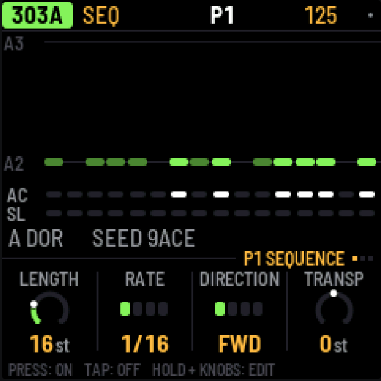

The generated notes remain editable with the normal step controls (section 6).

### Scale names

Intervals are semitone offsets from ROOT in twelve-tone equal temperament. Melodic Minor
uses its ascending form. These names identify the implemented note sets; the Thaat labels
are not a complete model of raga performance.

| Display | Scale | Intervals |
|---|---|---|
| MPEN | Minor Pentatonic | 0 3 5 7 10 |
| PMAJ | Major Pentatonic | 0 2 4 7 9 |
| EGYP | Egyptian Pentatonic | 0 2 5 7 10 |
| HIRA | Hirajoshi | 0 2 3 7 8 |
| MIN | Natural Minor | 0 2 3 5 7 8 10 |
| MAJ | Major | 0 2 4 5 7 9 11 |
| DOR | Dorian | 0 2 3 5 7 9 10 |
| PHRY | Phrygian | 0 1 3 5 7 8 10 |
| LYD | Lydian | 0 2 4 6 7 9 11 |
| MIXO | Mixolydian | 0 2 4 5 7 9 10 |
| LOCR | Locrian | 0 1 3 5 6 8 10 |
| HARM | Harmonic Minor | 0 2 3 5 7 8 11 |
| MELM | Melodic Minor | 0 2 3 5 7 9 11 |
| HMAJ | Harmonic Major | 0 2 4 5 7 8 11 |
| ALTR | Altered | 0 1 3 4 6 8 10 |
| GYPS | Hungarian Minor | 0 2 3 6 7 8 11 |
| ROMN | Romanian Minor | 0 2 3 6 7 9 10 |
| BHAI | Bhairav Thaat | 0 1 4 5 7 8 11 |
| MARV | Marva Thaat | 0 1 4 6 7 9 11 |
| PURV | Purvi Thaat | 0 1 4 6 7 8 11 |
| TODI | Todi Thaat | 0 1 3 6 7 8 11 |
| ARAB | Arabic | 0 2 4 5 6 8 10 |

The [supplementary German scale reference](TB3PO_SCALES.md) retains musical usage ideas.
The numeric indices deliberately changed: older saved scale selections may now resolve to
different scales. Projects and their written notes are retained, without automatic index migration.
The MPEN initialization default does not change existing saved scale selections.
Reselect the desired scale before generating or mutating, including automatic mutation.

To edit the line by hand, press SEQ; to shape its sound, EDIT.

---

## 8. Break

The break is a drum loop cut into eight slices, which X0X rearranges as it plays.


**Steps.** BREAK always uses 16 steps at 1/16 rate; it has no adjustable LENGTH/RATE or Remix.
The white keys are those 16 steps: press one to let the break play there, tap it
again to stop it.

**Playing slices.** Hold black keys 1–8 to play those slices yourself; let go and the generator
takes over again. Hold key 9 to play backwards, key 10 for half speed, key 11 to stutter.

**A step's own slice.** Hold a white key and press black key 1–8: that step now always plays
that slice of loop A, from its start, and its box shows the slice's number. Press the same black
key again (holding the step) to give it back to the generator. This way you can fix the kick and
snare where you want them and let the generator play with the rest.

**The generator.** SEQ has its two pages, GROOVE and RETRIG:

- COMPLEXITY: how often it jumps to a different slice instead of playing the next one. This is
  the amount: at 0 the loop plays straight, and ROLL and FILL come in with it, at full effect
  from 25%, so low settings stay close to the loop.
- ANCHOR: how strongly it keeps the kick and snare slices on beats 1 and 3.
- ROLL: how often it repeats a slice or moves to the one next to it.
- FILL: how much the last bar of a phrase breaks these rules.
- RETRIG 2X, 3X, 4X and 8X: the chance in each bar of stuttering a beat at that rate.

In SEL's list: PHRASE, the length of a phrase (2, 4, 8 or 16 bars, or off), and A LENGTH and B
LENGTH, how often a new slice is chosen (every 1/4 bar to every 8 bars).

**The loops.** EDIT has LOOP A, LOOP B, B CHANCE (the chance of switching to loop B in the last
bar of a phrase; with PHRASE off, in any bar) and PITCH. In v1.1.0 development, press EDIT again
for the SOUND page: FILTER and LEVEL. FILTER is OFF in the middle; turn left for a low-pass,
right for a high-pass. High-pass filtering can leave a loop's hats while the 909 or 808 supplies
the kick and snare. Older projects load with this filter OFF. Loops follow the
tempo by playing faster or slower, so their pitch follows it too, as on a sampler; PITCH shifts it
on top. X0X comes with two loops of its own, 909 GR and 808 GR, rendered by its own 909 and 808 engines at build time
(two bars each, 96 BPM, mono 22,050 Hz, 4-bit IMA ADPCM); loops you
upload come after them.

All of these, the steps, slices and loops, are saved with the pattern. The break's level, pan
and sends are on the mixer's PARTS page (LFO, black key 5).

### Your own breaks

In the emulator, load files into **Your breaks** below the device; no hardware connection is
needed. The separate [break loops page](https://mr-roboto.github.io/fm1-x0x-rmx/breaks/) is the
retained Web MIDI uploader for a compatible FM-1 in Chrome/Edge; it does not install firmware.
Existing user breaks were retained across a regular update in the release hardware test. They appear after X0X's own loops as BR1, BR2 and so on.
There's room for about 21 seconds in all: around nine one-bar loops.

<details><summary>From the command line</summary>

With the FM-1 connected, run:

```
python3 tools/upload_breaks.py --bars amen.wav think.wav funky.wav ...
```

`--bars` keeps one bar of each file; without it, each file is sent whole. This replaces all your
loops. `--dry-run FOLDER` shows what would fit without the FM-1. If you have schwung-breakbeat next
to X0X, `--bbgen` sends BB Gen's classic breaks. To build loops into a development firmware image, see
[BUILDING.md](../BUILDING.md).

</details>

---

## 9. Patterns


There are 32 patterns. A pattern holds each part's steps, the drums' and 303s' length/rate,
their Remix selections, the break's settings,
the swing, and any knob motion, p-locks and probabilities. Sounds, effects and master settings
are not part of a pattern and don't change when the pattern does.

Each part plays its own pattern, so the 303s can play pattern 3 while the drums play pattern 7.

**HOME** shows patterns 1–16 as boxes, one per white key; OCT+ shows 17–32 (P17-32 appears under
the boxes) and OCT- goes back. Every fourth box is numbered. In each box, a line for each part
with notes in that pattern: bright where that part is playing it now, dim otherwise.

**Choosing patterns**

- **All five parts:** on HOME, press a white key or turn PRESETS. From any other screen, hold
  HOME and press a white key.
- **One part:** on that part's screen (SEQ, EDIT, GRIDS or TB-3PO), turn PRESETS.
- **A chain:** on HOME, hold two white keys at once. All five parts play each pattern from the
  first to the second, a bar each, then start again. Choosing a single pattern ends the chain.

While playing, the new pattern starts when the current bar ends; stopped, it takes over at once.
A part that changes pattern starts again from step 1; the others carry on.

**Copy and paste.** Hold SAVE: the top line says P1 COPIED. Press a white key to paste onto that
pattern (P1 PASTED TO P2): all five parts, as they're playing now. If the pattern you paste onto
has notes, X0X asks first. While holding SAVE, OCT- and OCT+ switch between patterns 1–16 and
17–32.

**Clearing.** Hold SAVE and press REC to clear the selected part in its pattern. GLO > CLEAR
PATTERN clears all five.

**Muting.** On HOME, black keys 1–5 mute and unmute the parts. Mutes aren't saved, except inside
a song.

**Lengths and swing.** Parts can have different lengths, so they drift against each other. The
909's length sets the length of a bar, and the 909's pattern holds the swing, which applies to
every part. Swing delays every second step at 1/16 or 1/32 rate: 50% is straight, 75% the most.
The triplet rates remain straight.

HOME's knobs are for playing live: TEMPO, SWING, and the master's FILTER and PUMP.

### Remix

Remix reorders playback without rewriting the stored notes. Each of **909, 808, 303A and
303B** has its own selection in each project pattern. **BREAK is unaffected**. A Remix
selection such as B3 is not project pattern P3: project patterns are P1–P32, while the 256
Remix mappings are Bank A–P / Pattern 1–16.

1. Choose a part with ALGORITHM and a project pattern with PRESETS.
2. Press SEQ, then turn SELECT to the second page, **REMIX**. Both 303s use
   **SEQUENCE → REMIX → KEYS**; KEYS still contains only FREE PLAY ON/OFF.
3. Set **KNOB 2 BANK** and **KNOB 3 PATTERN**, then **KNOB 4 REMIX = ON**.
4. Set **KNOB 1 APPLY** to choose when a change becomes audible during playback.
   Stopped changes apply immediately. Start playback to hear the chosen mapping.

**A1** is the neutral sequential mapping, even with REMIX ON. New patterns default to
A1/OFF. On a 303, Remix acts only with DIRECTION = Forward. Reverse, Musical Reverse (MREV), Ping-Pong and Random
retain their existing playback; the Remix selection remains stored. Orb-style musical
reverse is not implemented.

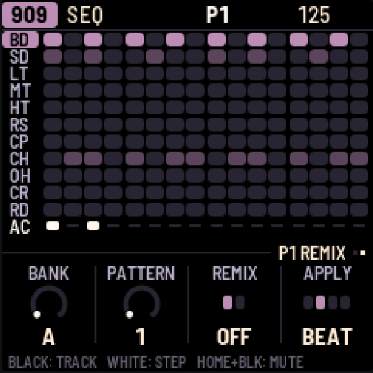
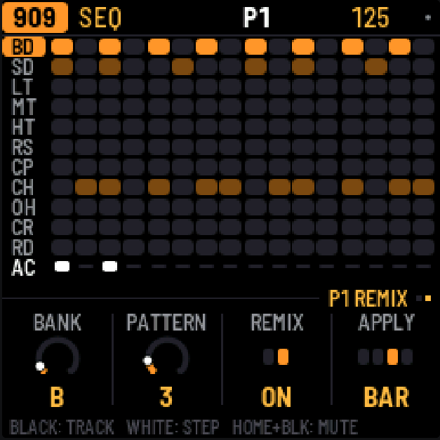

| APPLY | When a pending selection or ON/OFF change becomes audible |
|---|---|
| STEP | Next chronological step |
| BEAT (default) | Next incoming position 1, 5, 9, 13… |
| BAR | Next incoming position 1, 17, 33, 49 |
| LOOP | Next wrap of that part's pattern |

These boundaries follow the part's chronological step positions, regardless of which source
step Remix selects. APPLY is a saved global preference shared by the four parts, not part of
pattern Undo. BANK, PATTERN and ON/OFF are stored immediately and are undoable with the pattern;
the sound waits for APPLY. The latest edit replaces any pending selection. Stopping resolves
pending changes; switching project patterns adopts the new pattern's stored Remix state.

The same 16-slot mapping repeats within each 16-step block. A partial final block plays only
its required number of slots, but can still read any stored source step in that block. For
example, LENGTH 8 can read source steps 9–16; LENGTH 24 can read steps 25–32. The source data
is retained even when outside the currently playing length. Remix step 1 reads source step 1.

A drum mapping moves the whole column, including all drums and its accent. A 303 mapping
reads the selected note/rest/tie, accent and slide; tie lookahead follows the next mapped
slot. Motion, p-locks and probability follow the selected source too. Timing and swing stay
chronological. The lit playhead shows the mapped source when it is on the visible step page;
Remix does not move the page you are editing. Keys edit the stored steps, not a rendered Remix.

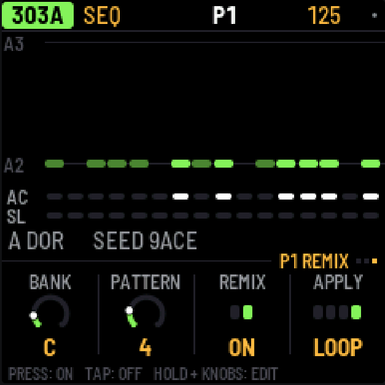

Copy/paste includes each part's Remix state. Clearing a part's steps preserves its Remix
selection and ON/OFF, as it preserves length and rate. Remix knobs cannot record motion or
p-locks. For recording sound motion while Remix is active, see section 11; for the sequencing
rules and storage layout, see the [Remix specification](REMIX_DESIGN.md).

---

## 10. Recording

Press REC to turn recording on, and again to turn it off.

- **Drums:** while the pattern plays, press black keys to record hits (with REC on you always
  hear them). Hold ENV for accented hits.
- **303, live:** with REC on, the 303's keys are a keyboard; play while the pattern runs.
- **303, step by step:** with REC on and the pattern stopped, each key you press fills the next
  step, from step 1. Hold ENV while pressing a key for an accent, or LFO for a slide. For a rest,
  hold ENV and press OCT- or OCT+; for a tie, hold LFO and press OCT- or OCT+.
- **Knob moves:** with REC on and the pattern playing, turn any sound knob (section 11).
- **The song:** REC + PLAY on the SONG screen (section 12).

---

## 11. Knob motion, p-locks and probability

All three give steps values of their own, and all three are saved with the pattern.

### Knob motion


Turn on REC, press PLAY and turn any sound knob. X0X records the knob on the steps where you moved
it, fills in short pauses so a slow sweep has no gaps, and on playback glides from step to step.

- A knob with motion has a dot in its corner, and its ring follows the recording as it plays.
- On steps you didn't touch, the knob's own setting plays.
- Turning the knob without REC takes over for one pass of the pattern; then the recording plays
  again.
- **To clear a knob's motion,** hold SAVE and turn the knob.
- Motion belongs to a part's pattern: the 303's knobs record into the 303's pattern; the effects
  and master into the 909's. Copying or clearing a pattern copies or clears its motion too.
- When you stop, every knob goes back to its own setting.

Wave motion on the 303s respects the one-Morph-voice limit. A conflicting request keeps the
previous effective Wave, and its ramp stops; releasing the owner does not replay that rejected
request. A new motion step can make a fresh request. The motion indicator shows the effective
Wave. If motion releases a voice's Morph setting and the other voice acquires Morph, the former
voice's base Wave is reconciled to its already effective Saw or Square. It will not silently
reclaim Morph when motion stops. Recorded lanes can still contain Morph requests; playback
checks each request against the active voice.

With Forward Remix ON, Motion recording changes the original source-step Motion
data for the events you hear. Short gaps still interpolate across chronological
positions, with each value written to its active mapped source step. Repeated
sources receive the latest write. Pending APPLY edits take effect for recording
only when the audible mapping switches. Playback with Remix OFF may therefore
sound different afterward. Other directions and BREAK record as before.

### P-locks

A step can have a sound of its own: a higher tune on one kick, an open filter on one 303 note,
the break pitched up for one step.

- On EDIT, hold a step that's on and turn a sound knob. That step plays the new value; the
  others keep the knob's. While you hold the step, the knob row says P-LOCK STEP 5, the knobs
  show the step's values, and an amber dot marks the locked ones. Stopped, you hear the lock
  while you hold the step.
- A tap still turns a step on or off: only a hold with a knob turn makes a lock. An empty step
  turns on as soon as you press it, so you can press, hold and lock in one go.
- **To clear one lock,** hold the step, hold SAVE and turn the knob.
- On SEQ, holding a step locks nothing (on a 303 the knobs set the step's note instead).

### Probability

Hold a step (on SEQ or EDIT) and turn SELECT to set the chance it plays, from 100% down to 5%
in steps of 5; the top line shows it (STEP 5: 50%). The dice are rolled every time the step comes
round, so 50% plays about every other pass.

Keep turning past 5% for **cycles**: 1:2, 2:2, 1:3 and so on up to 8:8. A step at 1:4 plays on the
first of every four times round its part's pattern, 2:4 on the second; nothing random about it.
Each part counts its own passes, from 1 again whenever you press PLAY or it changes pattern.

- On the 909 and 808 the chance belongs to the selected track's step, so the kick and the hats
  on one step can each have their own.
- On a 303 a skipped step is a rest; on the break, a skipped step doesn't fire.
- A skipped drum hit sends no MIDI note.

### Good to know

- Steps with p-locks or a chance below 100% have a small notch on the step grid.
- P-locks and probabilities are stored like recorded motion, one "knob" per locked setting per
  part pattern. There's room for 160 lanes across all patterns (each lane holds multiple steps); when it's full, the top line says
  MOTION FULL.
- Two locked steps next to each other glide from one value to the other, like a recording.

---

## 12. Song


A song is a list of up to 192 bars. Each bar says which pattern each part plays and which
parts are muted. To open the song, press HOME twice (HOME again comes back to the pattern).

- **Write bars:** press a white key. The selected bar gets that pattern for all five parts,
  and the next bar is selected. Pressing keys at the end of the song adds new bars.
- **Edit a bar:** turn KNOB 1 to select the bar, then use the other knobs to set each part's
  pattern for that bar.
- **Mute parts in a bar:** press black keys 1–5.
- **Repeat a bar:** on the SONG screen's second page (turn SELECT), REPEAT plays the selected bar
  up to 8 times (x2 … x8 shows at the end of its row), so four bars of the same pattern are one
  row.
- **Play the song:** press PLAY on the SONG screen. The song starts at the selected bar and
  loops, and keeps playing wherever you go (HOME for mutes, EDIT for sounds) until you stop it.
  While it plays, the top line shows S and the current bar number. PLAY anywhere else plays the
  patterns: whatever screen you start from decides, and the top line says which (S or P).
- **Record the song:** on the SONG screen, turn on REC and press PLAY. As it plays, change patterns
  and mute parts however you like. Each bar is written into the song as it goes by, starting
  from the bar you started on, and the song grows if you play past its end. Recording
  replaces what was in those bars before.

Press SEL on the SONG screen for LENGTH, INSERT BAR, DELETE BAR and CLEAR SONG.

---

## 13. Effects


There is one reverb and one delay, and every part can send to both: each part's sends are on the
mixer's PARTS page (LFO), each drum track's on 909 MIX and 808 MIX. FX shows how much every part
sends, and has two pages:

- REVERB: DECAY and TONE. The reverb is stereo: whatever you send it comes back wide.
- DELAY: TIME (in note values from 1/32 to a dotted half note), FEEDBACK, TONE and TAPE. TAPE at
  the far left (DIGI) is a clean 12-bit digital delay; turned up, it is a tape delay that wobbles,
  saturates and wears more the further you turn it, and can feed back on itself at high feedback.

In SEL's list, under MORE: each effect's low cut and return level, and PING-PONG, which bounces
the echoes between left and right.

---

## 14. Mix and master


Press LFO to open the mixer; press it again (or turn SELECT) for its four pages. The red bar on
the right is the compressor's gain reduction.

- **PARTS**: a level and a meter for each part. Press black keys 1-5 to pick the 909, 808,
  303A, 303B or the break; the knobs are its LEVEL, PAN, REV and DLY.
- **909 MIX** and **808 MIX**: each drum machine's own mixer, every track's level at a glance;
  the black keys pick a track, and the knobs set its LEVEL, PAN, REV and DLY.
- **MASTER**: four knobs over the whole mix. The screen shows the output level over the last
  couple of seconds, so you can see the pump and the compressor working.

On PARTS, 909 MIX and 808 MIX, hold HOME and press a black key to mute or unmute that channel (a
part on PARTS, a track on the drum pages). The key lights show it: the channel the knobs set is
bright (blinking while muted), the others dim, muted ones dark.

Turning ALGORITHM on the mixer goes to that part's page: 909 MIX or 808 MIX for the drum
machines, PARTS (with the part picked) for the 303s and the break.

| MASTER | What it does |
|---|---|
| DRIVE | Saturates the whole mix (the 909's drive stage). |
| COMP | One knob for the compressor: 0 is off; turning up lowers its threshold, raises its ratio and adds makeup gain together. Three quarters is the factory's hard squeeze (4:1 from -24 dB, +16 dB). |
| PUMP | Lowers the whole mix each time the kick plays, by up to 24 dB, and lets it swell back up: the big-beat breathing. Accented kicks pump harder. It works even with COMP at 0, and even when the kick is muted, so a silent kick can drive it. Which kick: PUMP BY in SEL's list (the 909's, the 808's or both). |
| FILTER | One knob: in the middle it's off; to the left a low-pass closes down, to the right a high-pass opens up. |

FILTER and PUMP are also on HOME's PERFORM page, for playing live.

> **The factory mix is set up for big beat:** the break up front with the 909 kick under it, the
> 303s through RAT distortion into a tape delay, reverb on the clap. For a clean mix, set COMP and
> PUMP to 0.

<details><summary>The master in detail</summary>

In SEL's list, under MORE: the compressor's THRESH (-48 to 0 dB), RATIO (1:1 to
20:1 and INF), ATTACK (0.1 to 100 ms), RELEASE (10 to 1500 ms), MAKEUP (0 to 24 dB) and MIX (dry
to fully compressed, for parallel compression); PUMP BY (the 909's kick, the 808's, or both); the
filter's RESO; LIMIT, which prevents clipping (leave it on); and the drive stage's DIST type, its
GLUE compressor and VOLUME. Turning COMP or FILTER sets their details again.

</details>

---

## 15. Settings and saving

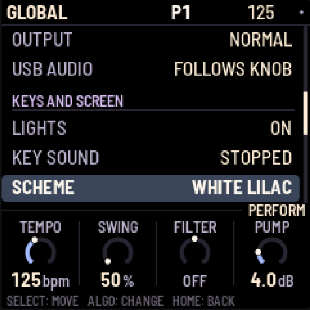

Press GLO for these settings, in five sections (MIDI, AUDIO, KEYS AND SCREEN, PROJECT, SYSTEM):

| Setting | What it does |
|---|---|
| CLOCK OUT | Sends MIDI clock and start/stop messages. |
| NOTES OUT | Sends the patterns out as MIDI notes. |
| 909 … BREAK MIDI CH | Each part's MIDI channel, for notes in and out: 1–16, or OFF to ignore incoming notes for that part (and send none). |
| OUTPUT | NORMAL, or LOUD: 6 dB more at the headphones and line out (and USB audio), for headphones that need it. The master's LIMIT (on by default) keeps it from clipping. |
| USB AUDIO | FULL (default for new projects and Factory Reset): USB audio stays at full level independently of the hardware MASTER knob. FOLLOWS KNOB remains selectable and follows MASTER. Saved settings are retained on update. |
| LIGHTS | ON: the key lights show the steps, and the unlit buttons glow dimly so they can be read. KEYS: the key lights only. OFF: neither. |
| KEY SOUND | STOPPED (the default): picking a drum or editing a 303 step is silent while the pattern plays, unless REC is on. ALWAYS: you always hear it. The 303 keyboard always plays either way. |
| SCHEME | Coordinated LCD and part colours: DEFAULT, WHITE LILAC, PINK LILAC, SUNSET ORANGE, GRAPHITE MINT or WHITE BLUE. WHITE LILAC is the factory default for new projects and reset. Saved schemes are retained. DEFAULT preserves the original colours, including the legacy screen palette in an older saved project. All schemes keep the black LCD background and red recording/warning indicators. |
| SAVE PROJECT | Saves everything. |
| AUTOSAVE | ON (the default): while the pattern is stopped, changes are saved by themselves once nothing has been touched for four seconds. OFF: only SAVE saves. |
| CLEAR PATTERN | Clears all five parts of the current pattern. |
| FACTORY RESET | Goes back to the factory sounds and empty patterns, with no song and no knob motion, and selects WHITE LILAC. Your saved project is kept until you save over it. |
| PERFORMANCE | Opens the performance page (below). |
| ABOUT X0X | Shows the version, how full the memory for patterns is (MEM), and the audio load. |
| BATTERY | The battery's charge: FULL, 2/3, 1/3 or EMPTY; USB POWER while a computer powers the FM-1. Read only. |

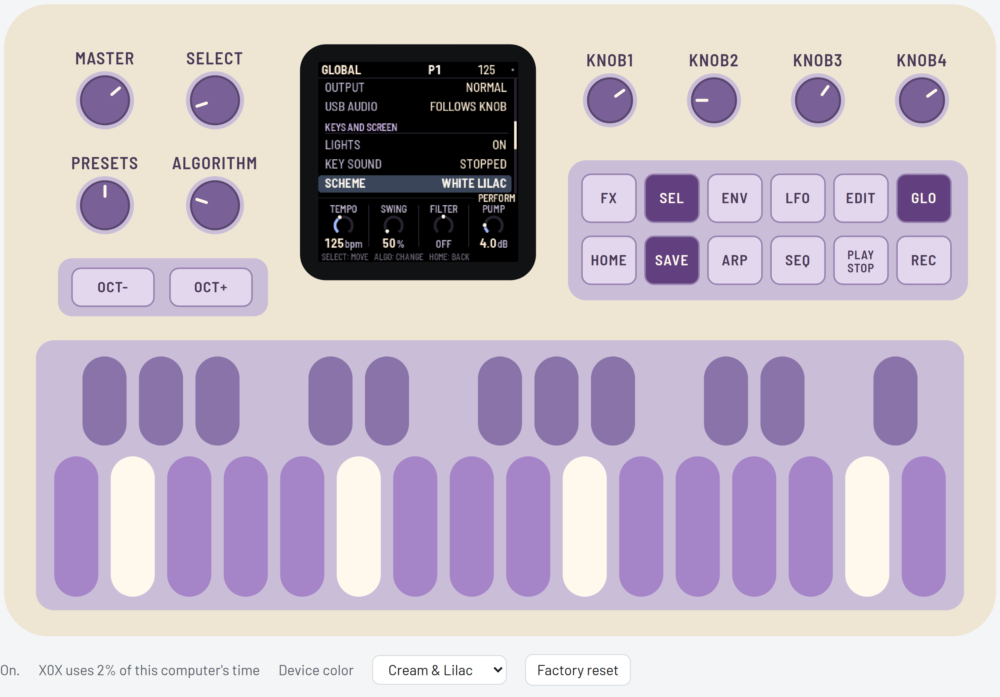

The browser **Device color** selector changes only the exterior illustration. **GLO → SCHEME**
changes the LCD and part colors. Neither control changes the other; the exterior preference
is stored separately from the saved project.

### What is remembered

| Item | Lifetime |
|---|---|
| Steps, length/rate, Remix selection and ON/OFF, TB-3PO settings, break settings, motion/p-lock/probability lanes | Saved with the project patterns; included in pattern copy and Undo |
| Sounds (including both Morph values), mix, effects and song | Saved with the project; undoable |
| Manual startup pattern combination for 909/808/303A/303B/BREAK | Saved by SAVE/AUTOSAVE; restored at power-on; automatic Song/Chain changes do not replace it |
| Tempo, GLOBAL settings, LCD SCHEME and Remix APPLY | Saved with the project; outside Undo |
| Grids knobs and random state | Session only; separate for 909/808; outside project saving and Undo |
| Undo/Redo history, free-play switches and live mutes | Session only; song-bar mutes are saved in the song |
| Browser Device color | Saved separately as a browser visual preference |
| Browser break slots | Saved separately in browser storage |

### Saving

SAVE and AUTOSAVE remember the last **manually chosen combination** of project patterns
for all five parts, including BREAK. PRESETS on a part changes that part; PRESETS on HOME
and HOME white pattern keys choose all five. A queued manual selection is remembered even
before it becomes audible. Song playback and automatic chain advancement never replace
this startup combination. Defining a chain remembers its first manually selected pattern;
its automatic advances do not become the startup pattern. Older projects without startup
fields begin at P1 on all parts. Pattern selections cause no immediate flash writes.


**SAVE** saves the sounds, all 32 patterns, the song, the knob motion, the tempo and the
settings. A small grey dot at the top right of the screen means there are unsaved changes, and
anything unsaved is lost when you switch off.

For experimental Wave 3, each 303's Morph value is saved independently. Wave selections go
through the audio command queue: saving uses the last audio-accepted settings, including if a
new selection has not yet been processed. Rejected selections never replace those saved Wave
values. A conflicting loaded pair resolves to Morph on A and Saw on B.

With **AUTOSAVE** on (the default) you'll rarely need SAVE: whenever the pattern is stopped and
nothing has been touched for four seconds, X0X saves and says AUTOSAVED.

> **X0X never saves while playing.** Saving pauses the sound for a moment (the FM-1 plays from the
> same memory it saves to), so a SAVE pressed while playing says SAVES WHEN STOPPED and saves when
> you stop.

<details><summary>How much fits</summary>

X0X packs the patterns, the song and the knob motion to fit them in the FM-1's memory; empty
steps take almost no room, so a typical project uses a small part of it (GLO > ABOUT X0X shows
how much, as MEM). If a project ever grows too big to fit, X0X says MEMORY FULL: NOT SAVED and
keeps what was saved before; clearing patterns you don't need makes room. Projects from the older 32-step/16-pattern format retain their written steps and patterns
when migrated. The TB-3PO scale-index and Morph-default caveats above still apply.

</details>

<details><summary>Performance: how hard the FM-1 is working</summary>

GLO > PERFORMANCE shows how hard the FM-1 is working, updated every second: the audio load and
its peak, any dropouts, and how much of the processor each part is using.

For a proper measurement, press SEL and choose RUN PERF TEST. X0X plays three patterns of its
own for about 15 seconds, from a simple loop up to everything as busy as it gets, then puts your
project back exactly as it was and shows the results. HOME or PLAY stops the test early.

The physical-device implementation uses both of the FM-1's processor cores: the 808 and the break run on the second, so the 808's
share on the performance page is the time the first core waits for them, and the whole load is lower: on
an upstream X0X FM-1 the test's three patterns went from 43%, 83% and 115% on one core to 39%, 54% and 68%,
and the busiest moment of the worst case from over the limit to 84%. These are historical
upstream measurements, not timing results for X0X-RMX, Grids or Morph. The release hardware run reported no problems over twelve minutes; separate worst-case
performance figures were not reported. Browser load figures measure the computer, not the FM-1.

The top right of the performance page says 2 CORES. On some FM-1s the second core reads its work
wrongly; X0X notices the first time and carries on with one core, and the page says 1 CORE: BAD
READS in red. Everything still works, but the busiest patterns may drop out.

When the FM-1 gets close to its limit, X0X lightens the load by itself instead of dropping out:
the 303s stop oversampling (bright, resonant notes get a touch grittier) and the 808's sounds end
a little sooner as they fade. While this is happening, GUARD lights up in amber next to the audio
load; it switches off again after three quiet seconds. The performance page counts how often it
has kicked in (GUARD 3x).

If X0X drops out on one of your patterns, a photo of the test results and of the pattern is the
most useful thing you can send.

KNOB 1 turns on some extra counters (STALLS). They're experimental: if the FM-1 acts up with them
on, switch it off and on again.

</details>

---

## 16. MIDI and USB audio

This section describes the retained physical-device interfaces. They are not exposed by the
browser emulator. USB audio with iPad/AudioShare was confirmed successful on the release
firmware. Separate FULL and FOLLOWS KNOB hardware tests were not reported and are not claimed.

When connected over USB, the FM-1 shows up as a MIDI device called "X0X FM-1".

X0X takes MIDI from USB and from the FM-1's TRS MIDI IN jack, both the same way. Each part
listens on its own channel; these are the defaults:

| Input | What it plays |
|---|---|
| Channel 10 | The 909, with General MIDI drum notes: 36 kick, 38 snare, 41, 45 and 50 toms, 37 rim, 39 clap, 42 closed hat, 46 open hat, 49 crash, 51 ride. |
| Channel 11 | The 808, with the same notes, plus 56 for the cowbell and 49 for the cymbal. |
| Channel 2 | 303A. Overlapping notes slide, and a velocity of 100 or more plays an accent. |
| Channel 3 | 303B, in the same way. |
| Channel 4 | Notes 36–43 play break slices 1–8. |
| Clock | X0X follows an incoming MIDI clock automatically, and returns to its own tempo half a second after the clock stops. Start, Stop and Continue start and stop the patterns. |

GLO sets each part's channel (909 MIDI CH and so on), or OFF to ignore its notes, for example when
another box sends you its clock with notes on the same channels. X0X can also send MIDI: clock and
start/stop when CLOCK OUT is on, and the patterns as notes on each part's channel when NOTES OUT
is on.

While X0X follows an external clock, the tempo on the top line is averaged over about a second,
so it doesn't flicker with every clock.

### USB audio

Over the same USB cable, the FM-1 also shows up on a computer as an audio input called
"X0X FM-1": two channels at 44.1 kHz, with no driver to install. It carries what the headphones
hear, after VOLUME, in stereo.

Record it in any audio app, or monitor it live through one. The FM-1 keeps its USB audio in step
with the computer's clock, so live monitoring doesn't drift or drop out. The first moment after an
app opens the input can click while the FM-1 settles.

---

## 17. Troubleshooting

For browser audio, click Switch on, check the site/tab is not muted and raise MASTER.
Reloading starts a new session and loses unsaved edits. For persistent startup trouble, note
the browser version and the displayed error before reporting an issue.

The hardware procedures below are retained from original X0X. Version numbers in them refer
to upstream history, not X0X-RMX releases. No public X0X-RMX installer or package is available.

**Update mode:** hold OCT- and OCT+ together for five seconds. A countdown appears; let go
before it ends to cancel.

**Calibration:** if a button or knob does the wrong thing, hold OCT- and OCT+ while you switch
the FM-1 on. The screen then asks you to press each button and turn each knob in turn.

**After a crash:** X0X shows a red CRASH screen and restarts by itself a few seconds later. The
next start shows RESTARTED AFTER A CRASH and an address (PC ...) for a moment. If you report the
problem, include that address and what you were doing.

**Safe mode:** if X0X crashes twice in a row while starting, it starts in SAFE MODE instead. There's
no sound, but USB works, so compatible upstream installation/recovery tooling can reach it. The X0X-RMX
[installer](https://mr-roboto.github.io/fm1-x0x-rmx/install/) can reinstall the release; its
stock-firmware option requires a user-supplied stock package. Press PLAY to try starting X0X normally again. If even safe
mode fails twice, the FM-1 drops into the chip's own update mode, and only the rescue below can
reach it.

<details><summary>Stuck on the start screen after changing BRIGHTNESS (0.9-beta and earlier)</summary>

Versions up to 0.9-beta had a brightness setting that could freeze the FM-1, and because the
setting was saved, it stayed frozen at every start, even after reinstalling. The upstream fix was to install original X0X 0.10-beta or
later using its installer: the setting is gone, the saved value is ignored, and the FM-1 starts
normally.

</details>

### Recovering an FM-1 that will not start

Since 0.5-beta, an FM-1 that keeps crashing starts in safe mode (above), where the web installer
can fix it. Older versions instead dropped into the chip's own update mode after two crashes (0.2-
beta did this: the X0X screen, a red X0X CRASH screen, then a blank screen). Neither the web
installer nor M-VAVE's updater can see an FM-1 in that state, but a script can put M-VAVE's
firmware back, on a Mac, with the USB cable you already have:

Open Terminal, paste this line and press Return:

```
bash -c "$(curl -fsSL https://raw.githubusercontent.com/charlesvestal/fm1-x0x/main/tools/fm1_rescue.sh)"
```

1. If a window asks to install the command line developer tools, click Install. When it has
   finished, paste the line again.
2. If it asks for a password, type your Mac password (nothing shows as you type) and press Return.
3. When it says it's waiting, plug the FM-1 in and switch it on. It crashes and goes blank, and
   the script catches it. It checks the chip, saves a backup of the FM-1's memory in the
   `fm1-rescue` folder in your home folder, and asks before it writes anything.
4. Type **yes** and press Return. Don't unplug anything until it says it's restarting the FM-1.
   The FM-1 then starts into its original firmware. To install X0X-RMX afterwards, use the
   checksum-verified v1.0.1 Stable package and its public installer.

The script downloads M-VAVE's FM-1 V15 firmware and JieLi's flash loader, and checks both against
known fingerprints. It writes only the firmware area of the memory, never the bootloader or the
FM-1's own settings, and checks everything it writes. This is the retained upstream recovery procedure, not an X0X-RMX hardware-validation result. If it fails,
copy everything in the Terminal window and
[open an X0X-RMX issue](https://github.com/Mr-Roboto/fm1-x0x-rmx/issues). If the FM-1 never shows up at
all, Felucca's [FM-1-transporter](https://github.com/kurogedelic/FM-1-transporter) (a small
RP2040 board wired to the USB lines) can still reach it.

---

## 18. Parameters

Drum settings range from 0 to 127. DIST, the distortion type, can be DIODE, CLIP, SAT, BFZ,
PDIST, FOLD or CRUSH. PAN goes from L64 through C (the middle) to R63.

Each track's Level, Pan, Rev and Dly are on the mixer (909 MIX, 808 MIX); its Drive and Dist are
in SEL's list; the rest are its sound pages.

<details><summary>909 tracks</summary>

| 909 track | Settings |
|---|---|
| BD | Tune, Attack, Decay, Level, Pitch depth, Pitch, Drive, Dist, Rev, Dly, Pan |
| SD | Tune, Tone, Snappy, Decay, Level, Drive, Dist, Rev, Dly, Pan |
| LT, MT, HT | Tune, Decay, Level, Attack, Drive, Dist, Rev, Dly, Pan |
| RS | Level, Tune, Drive, Dist, Rev, Dly, Pan |
| CP | Level, Tune, Tail, Drive, Dist, Rev, Dly, Pan |
| CH, OH | Decay, Level, Tune, Drive, Dist, Rev, Dly, Pan |
| CR, RD | Tune, Level, Decay, Drive, Dist, Rev, Dly, Pan |
| KIT | Accent (how much louder accented steps are) |

</details>

<details><summary>808 tracks</summary>

| 808 track | Settings |
|---|---|
| BD | Level, Tone, Decay, Tune, Attack, Drive, Dist, Rev, Dly, Pan |
| SD | Level, Tone, Snappy, Tune, Decay, Drive, Dist, Rev, Dly, Pan |
| LT, MT, HT | Level, Tune, Decay, Sound, Drive, Dist, Rev, Dly, Pan |
| RS | Level, Tune, Decay, Sound, Drive, Dist, Rev, Dly, Pan |
| CP | Level, Tune, Decay, Attack, Sound, Drive, Dist, Rev, Dly, Pan |
| CB, CH | Level, Tune, Decay, Drive, Dist, Rev, Dly, Pan |
| CY, OH | Level, Decay, Tune, Drive, Dist, Rev, Dly, Pan |
| KIT | Accent |

</details>

<details><summary>303</summary>

| 303 setting | Range |
|---|---|
| Cutoff, Reso, EnvMod | 0–127 |
| Decay | 200–2000 ms |
| Accent | 0–127 |
| Wave | Saw, Square or Morph; only one 303 may use Morph at a time |
| Morph (EXTRA) | 0–127; 0 Sharkfin, 64 Trapezoid, 127 Notch-Trapezoid; default 64 |
| Tune | A4 from 400 to 479.375 Hz; pot 64 is 440 Hz |
| Volume | 0–127 |
| Drive | 0–127; 0 bypasses drive |
| Drive type (DRVTYPE) | Off, Soft or RAT |
| Slide | 2–360 ms |
| Accent decay | 30–3000 ms |

</details>

<details><summary>Break</summary>

| Break setting | Range |
|---|---|
| Complexity, Anchor, Roll, Fill | 0–100 |
| Retrig 2x, 3x, 4x, 8x | 0–100 |
| Phrase | Off, 2, 4, 8 or 16 bars |
| B chance | 0–100 |
| A length, B length | 1/4, 1/2, 1, 2, 4 or 8 bars |
| Level | 0–127 |
| Pitch | -12 to +12 semitones |
| Filter (v1.1.0 development) | LP 100%–1%, OFF, HP 1%–100% |

</details>

<details><summary>Effects and master</summary>

| Effect page | Settings |
|---|---|
| REVERB | Decay, Tone; in the list: low cut, return level |
| DELAY | Time (1/32, 1/16T, 1/16, 1/8T, 1/16., 1/8, 1/4T, 1/8., 1/4, 1/2T, 1/4., 1/2, 1/2.), Feedback, Tone, Tape (DIGI, then tape and its wear); in the list: low cut, return level, ping-pong |
| MASTER | Drive, Comp, Pump, Filter; in the list: the compressor's details, pump by, resonance, limiter, the drive's type, glue and volume |

The delay follows the tempo, including an external MIDI clock. A delay longer than two seconds
(1/2. below 90 BPM, 1/2 below 60) plays at half that length, which still lands on the beat. With
PING on, the echoes bounce from left to right, one delay time apart; delays longer than one
second play in the middle instead.

</details>

---

## 19. Credits

X0X-RMX is distributed under **GPL-3.0-only**. Preserve the component notices and provide
complete corresponding source when distributing it. See [LICENSING.md](../LICENSING.md)
and the [GPLv3 text](https://github.com/Mr-Roboto/fm1-x0x-rmx/blob/orb-remix/LICENSE) for the full project notices and terms.

- **X0X-RMX** is an independent fork of [Charles Vestal's X0X](https://github.com/charlesvestal/fm1-x0x).
- The platform (hardware layer, USB, update loader, installer and storage) is from
  [**Felucca**](https://github.com/hugelton/Felucca) by Leo Kuroshita (@kurogedelic), Hügelton Instruments.
- The 909 is ported from [**9W9**](https://github.com/athousanddetails/schwung-9W9)
  (athousanddetails), based on [**ER-99**](https://github.com/matthewcieplak/er-99) by Matthew
  Cieplak. Its hi-hat, ride and crash samples are ER-99's (GPL-3.0).
- The 808 is ported from [**8W8**](https://github.com/athousanddetails/schwung-8W8)
  (athousanddetails), with circuit-model references to Werner / Abel / Smith and rim-shot
  lineage from sc808 (Yoshinosuke Horiuchi / Sam Aaron).
- The 303 is ported from [**schwung-303**](https://github.com/charlesvestal/schwung-303)
  by Charles Vestal, built on **Open303** by Robin Schmidt (MIT), with Devilfish extensions
  from **jc303** (midilab) and RAT drive from **dm-Rat** (Dave Mollen). The port notices also
  credit mystran & kunn for the TeeBee-filter coefficients.
- TB-3PO is ported from [**schwung-tb3po**](https://github.com/charlesvestal/schwung-tb3po)
  by Charles Vestal, from the **Phazerville Hemisphere Suite TB_3PO** applet by djphazer
  and contributors. X0X-RMX adds its scale-aware phrasing and mutation behavior.
- Grids rhythm maps and MAP arithmetic are by **Emilie Gillet / Mutable Instruments**
  (GPL-3.0-or-later). **DEADACTIVE's Hortator** is the C-arithmetic reference used for
  cross-checking, not the original author of Grids. Pinned sources and adaptation differences
  are recorded in [Grids attribution](../assets/grids/README.md).
- The break generator is ported from [**BB Gen / schwung-breakbeat**](https://github.com/mestela/schwung-breakbeat)
  by mestela, used with the author's permission as recorded in the project notices. Built-in
  loops are rendered by X0X's own 909; recordings you load retain their own copyright.
- The firmware fonts are **Barlow Semi Condensed** (The Barlow Project Authors) and
  **Terminus** (Dimitar Toshkov Zhekov), SIL OFL 1.1. Web typography also uses Barlow;
  the retained **Fukiai** web icon font (Hügelton Instruments) is MIT-licensed.
- [**Groove OS**](https://www.groove-os.com/) by Peter Gombos inspired running FM-1 firmware
  in a browser; no code from it is used.
- Remix lookup data was transcribed, analyzed and manually compiled by project owner
  **Mr-Roboto**, from his Cubase MIDI recordings of all 256 physical Future Retro Orb
  patterns. That table became the historical **Kontakt/Luminary** source. His compilation
  credit is separate from Future Retro's original patterns and hardware, without claiming
  underlying intellectual-property ownership or resolution of all licensing questions. See
  [Remix provenance](../assets/remix/README.md). **Future Retro Orb** describes the musical
  inspiration, not an affiliation, an endorsement or a claim that Orb firmware is included.

M-VAVE and FM-1 are trademarks of their owners, and TR-808, TR-909 and TB-303 are Roland
trademarks. X0X-RMX does not imply endorsement by Charles Vestal and is not connected with M-VAVE, Roland or Hügelton Instruments.
